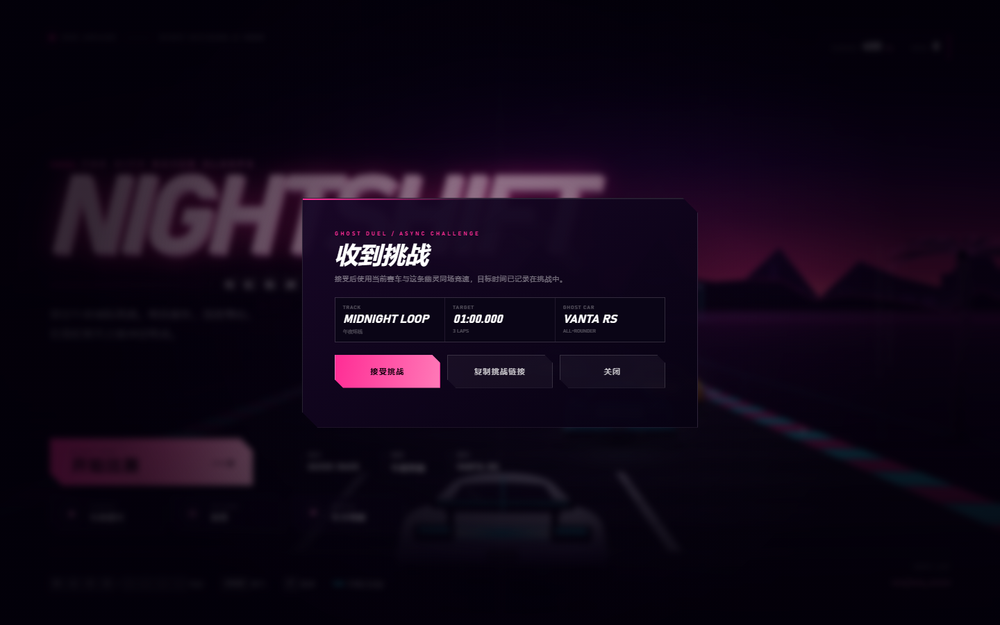

# NIGHTSHIFT · 霓虹极速 7.1

一款可以直接在浏览器里玩的霓虹合成波（Synthwave）风格 **WebGL 3D** 街机赛车游戏。无需安装、无需联网、无外部素材，所有车辆、赛道场景、粒子和音效都由代码实时生成。

## 开始游戏

直接双击 `index.html`（或双击 `启动游戏.bat`）即可开始。

- 推荐使用 Chrome / Edge 等现代浏览器
- 建议开启声音；音效和背景音乐使用 Web Audio 实时合成
- 支持键盘、手柄和触屏，支持横屏 / 竖屏
- 可在设置中安装为桌面/主屏幕应用，首次加载后支持离线
- 在线试玩：https://boriswzb.github.io/racing-game/

## 7.0 内容

### WebGL 3D 渲染

- 默认使用 **WebGL** 渲染真实 3D 追逐场景
- 赛道是闭合的 3D 中心线，包含连续弯道、起伏和坡度
- 3D 追逐相机、透视投影、深度测试与雾化
- 3D 霓虹路面、路肩、护栏、车道线
- 3D 门架与霓虹灯柱，车辆带有地面接触阴影
- 车辆、棕榈树、灯柱、广告牌以 3D billboard 方式渲染
- 程序化天空、星空、太阳、远山与地平线
- 4 条赛道拥有不同的闭合 3D 路线与高度剖面
- 迷你地图直接使用真实 3D 赛道中心线
- 可在设置中切换：自动 / 3D · WebGL / 2D · 兼容
- WebGL 不可用或上下文中断时自动回退到 Canvas2D
- 2D 兼容模式继续使用同一套赛道曲率，保留完整玩法
- 回放与照片模式同时支持 3D 场景；照片会合成 WebGL 与粒子层

**如何确认正在使用 3D**
- 打开「设置 → 渲染器」，底部会显示 `当前渲染器：WEBGL 3D` 或 `CANVAS 2D`
- 也可以直接打开 `https://boriswzb.github.io/racing-game/?webgl=1` 强制 3D
- 如果仍显示 2D：先强制刷新（`Ctrl+Shift+R`），或在浏览器开发者工具中注销 Service Worker；仍不行则说明设备/浏览器 WebGL 不可用，会自动回退到 2D

### 四条赛道

- **MIDNIGHT LOOP / 午夜环线**：适合第一次夜跑的高速环线
- **NEON HARBOR / 霓虹港湾**：连续 S 弯，节奏紧凑
- **CRIMSON PASS / 赤色山口**：大起伏、高速盲弯与荒漠灯光
- **SKYLINE SPRINT / 天际冲刺**：短促密集的城市技术赛道

每条赛道拥有独立的天色、雾色、山体、城市/荒漠装饰、路面霓虹、最佳纪录与本地 Top 5。

### 三台赛车与永久改装

| 赛车 | 特点 | 解锁 |
| --- | --- | --- |
| VANTA RS | 均衡、稳定 | 初始 |
| KAZE GT | 轻量、转向快、加速强 | 800 CR |
| NOVA X | 极速最高、抓地较低 | 1800 CR |

每台车有 4 条改装线，各 5 级，改装永久保存：

- **ENGINE 引擎**：每级 +220 极速
- **CHASSIS 轮胎 / 悬挂**：每级 +0.04 抓地、+0.015 转向
- **NITRO 氮气系统**：每级 +220 氮气极速、加快回充
- **WEIGHT 轻量化**：每级 +260 加速

改装费用逐级提高（120 / 200 / 320 / 480 / 700 CR）。升级会实时反映在车辆性能条和实际驾驶中，AI 不会跟着升级，因此改装能带来真实优势。

### 生涯模式

5 场逐步解锁的赛事，从「第一夜」到「午夜之王」，包含不同赛道、圈数、AI 难度和领奖台目标。完成目标可获得 CR、解锁下一场赛事，并记录最佳名次、奖牌与最佳时间。

### 每日挑战与成就

- 每天生成 3 个挑战，完成后自动发放 CR，每日 00:00 刷新
- 挑战类型包括完赛、领奖台、胜利、漂移、氮气、极速和零失误单圈
- 12 个成就，覆盖首胜、收藏、生涯通关、赛道纪录、漂移、氮气、极速、零失误和每日挑战
- 成就解锁时自动发放 CR，并显示在结算卡片中
- **车手档案**页面集中查看每日挑战、成就进度、生涯统计和每条赛道的本地 Top 5

### 驾驶与比赛系统

- 带惯性、抓地、漂移和转向辅助的操控模型
- 实体护栏碰撞、出界减速、追尾与撞墙反馈
- 尾流（Slipstream）加速与实时提示
- 5 名 AI 对手：赛车线、超车避让、防守、失误与难度差异
- 起跑灯、倒计时、圈数、实时排名、分段计时、Delta、迷你地图
- 幽灵车（本赛道最快圈回放）与实时 **GHOST Delta**
- 分段最佳、最佳单圈、赛道纪录、本地 Top 5 全部本地保存
- 低/标准/高转向辅助，近/远两档镜头，自动油门与幽灵开关
- 手柄支持：左摇杆转向、RT 油门、LT 刹车、A 氮气、Start 暂停

### 赛事回放

每场比赛都会以 10Hz 记录玩家与全部 AI 的位置、速度、走线和姿态。

- 结算页点击「观看回放」即可重看刚才的比赛
- 创造赛道纪录时，回放会随纪录永久保存
- 在「车手档案 → 赛道纪录」中可随时回放该赛道的最佳比赛
- 支持播放 / 暂停、时间轴拖动、0.5× / 1× / 2× 倍速
- 支持追随 / 高空两种镜头
- 回放使用独立覆盖层，不打断 HUD 和比赛状态；退出后回到结算或档案

### 照片模式

回放中随时进入照片模式：

- 隐藏全部 HUD 和回放控件，只保留画面
- 先暂停在任意时刻，选择镜头后再进入
- 「保存照片」直接导出当前 Canvas 为 PNG（不包含界面）
- 适合做壁纸、分享比赛瞬间或记录赛道氛围

### 安装、离线与画质

- **PWA 安装**：在设置中点击「安装」即可作为独立应用启动（Chrome / Edge / Android）
- **离线游玩**：Service Worker 缓存游戏外壳，首次加载后断网也能启动
- **自动更新**：新版本下载完成后会提示「刷新后生效」
- **画质设置**：自动 / 高 / 均衡 / 性能
  - 自动根据设备、触屏和 CPU 核心数选择
  - 画质会影响分辨率上限、绘制距离、粒子上限与远景细节
  - 低画质适合老设备 / 高 DPI 手机，高画质保留完整霓虹远景
- 安装与离线不影响本地进度：CR、改装、纪录、回放和照片仍然保存在本机

### 本地照片库

- 照片模式保存时，同时下载 PNG 并写入浏览器 **IndexedDB**
- 在「车手档案 → 照片」查看最近 12 张照片
- 支持在照片库中再次下载或删除
- 照片不会上传到服务器
- 旧照片超过 12 张时自动清理最早的照片

### 异步幽灵挑战

把一条赛道纪录变成可分享的挑战链接，不需要服务器：

- 在「车手档案 → 赛道纪录」点击某条纪录的「挑战」
- 生成包含幽灵轨迹、目标时间、圈数和赛车信息的挑战链接
- 复制链接或挑战代码发给好友
- 好友打开链接会自动弹出挑战卡片，接受后直接进入 **GHOST DUEL**
- 也可在「赛道纪录 → 导入挑战」粘贴链接或代码
- 挑战中会显示幽灵车、实时 GHOST Delta 和目标成绩
- 冲线后结算会显示「已击败 / 未击败」目标
- 挑战赛不会覆盖正式赛道纪录、Top 5 或最佳回放
- 幽灵轨迹会压缩到约 180 个采样点，链接在大多数聊天工具中可正常发送

## 操作

| 操作 | 键位 |
| --- | --- |
| 转向 | `A` / `D` 或 `←` / `→` |
| 油门 | `W` / `↑` |
| 刹车 | `S` / `↓` |
| 氮气 | `Space` / `Shift` |
| 暂停 | `P` / `Esc` |
| 静音 | `M` |
| 重新开始 | `R` |

触屏端：左下角转向，右下角油门 / 刹车 / 氮气。设置中可开启「自动油门」。

回放中：`Space` / `P` 播放暂停，`←` / `→` 前后 2 秒，`C` 切换镜头，`F` 照片模式，`Esc` 退出；照片模式中 `Enter` / `S` 保存 PNG。

## 小提示

- 高速过弯时会有离心力，提前反打方向，避免冲出赛道。
- 撞上护栏会大幅掉速并触发屏幕震动，也会破坏零失误单圈。
- 跟在对手正后方可以进入尾流，获得额外加速和氮气回充。
- 氮气会缓慢回充，每完成一圈额外补充；留在直道使用。
- 每场赛事结束后根据名次获得 CR；重复挑战可以刷新纪录、每日挑战和成就进度。
- 幽灵车默认开启，可以在设置中关闭；GHOST Delta 为相对最快幽灵的实时差距。
- 在「车手档案 → 赛道纪录」生成挑战链接，好友打开后可直接与你的幽灵竞速。
- 优先升级当前常用赛车，比分散投资三台车更划算。

## 技术特性

- WebGL 3D 起伏赛道、闭合中心线、透视追逐相机与动态雾化
- 程序化赛车 / 棕榈树 / 灯柱 / 广告牌 / 龙门架 / 荒漠岩石与仙人掌
- 3D 霓虹路面、路肩、护栏、车道线、天空与远山
- Canvas 2D 粒子、速度线、屏幕震动和 HUD，可独立回退到 2D 渲染
- Web Audio 合成引擎声、风噪、氮气声和 Synthwave 背景音乐
- 本地 profile v3 存档（CR、车辆、改装、赛事、每日挑战、成就、Top 5、幽灵车、回放、设置）
- 比赛回放以 10Hz 记录玩家与 AI，最佳比赛回放随赛道纪录保存
- 照片模式通过 Canvas `toBlob` 导出无界面 PNG，并写入 IndexedDB 照片库
- 异步幽灵挑战使用 base64url 编码的压缩轨迹，无需后端即可分享链接
- PWA manifest + Service Worker 离线缓存，支持桌面/移动安装和自动更新提示
- 画质档位动态调整 DPR 上限、绘制距离和粒子预算
- 旧版 2.x 存档自动迁移
- 响应式布局与触屏控制

## 文件

- `index.html` — 页面结构、HUD、赛事选择、生涯、车手档案、回放/照片与设置界面
- `styles.css` — 界面、主题色、改装/档案/回放/照片页面与响应式样式
- `game.js` — 渲染、物理、AI、改装、任务、成就、回放、照片库、音效、存档与全部游戏逻辑
- `manifest.webmanifest` — PWA 应用信息
- `sw.js` — 离线缓存与版本更新
- `icon-192.png` / `icon-512.png` / `apple-touch-icon.png` — 安装图标
- `启动游戏.bat` — Windows 一键启动

## 浏览器兼容

推荐 Chrome / Edge 90+、Firefox 90+、Safari 15+。
游戏使用 WebGL 1.0、Canvas 2D、Web Audio、Gamepad API、IndexedDB、Service Worker、pointer events 和 `dvh` / `clip-path` 等现代 Web API。

默认优先使用 WebGL 3D；不支持 WebGL 或上下文丢失时会自动回退到 Canvas2D。也可以在设置中手动选择「2D · 兼容」。

PWA 安装与离线缓存需要 HTTPS 或 localhost；直接双击 `index.html` 仍可正常游玩，但不会注册 Service Worker。iOS Safari 可通过「分享 → 添加到主屏幕」安装。
