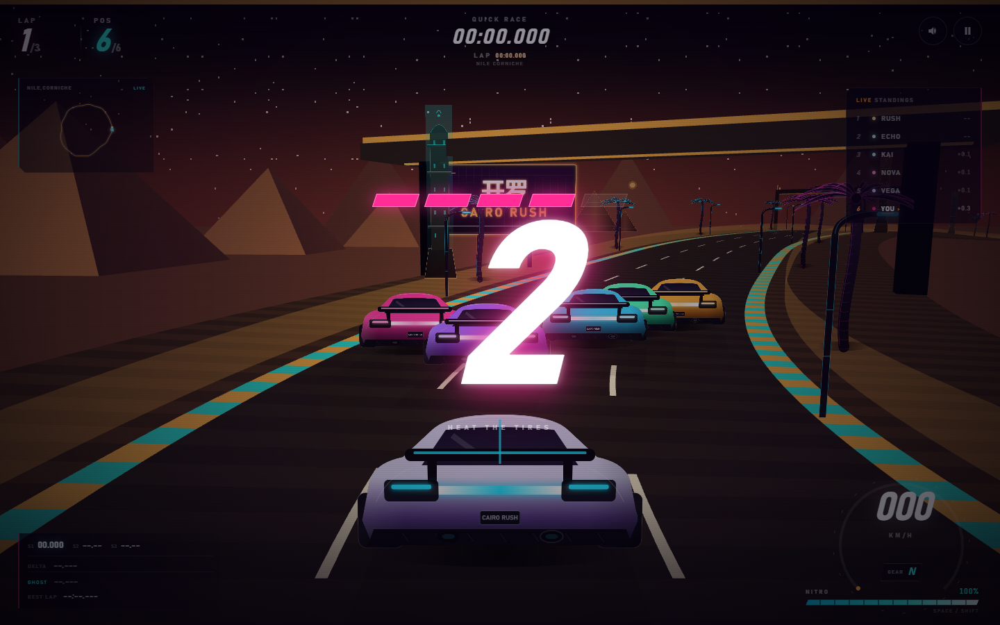
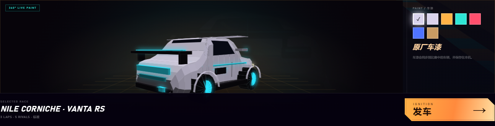
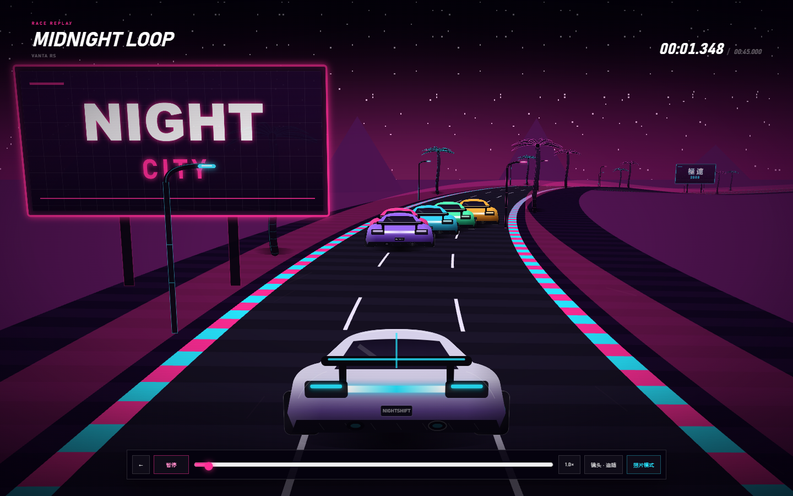
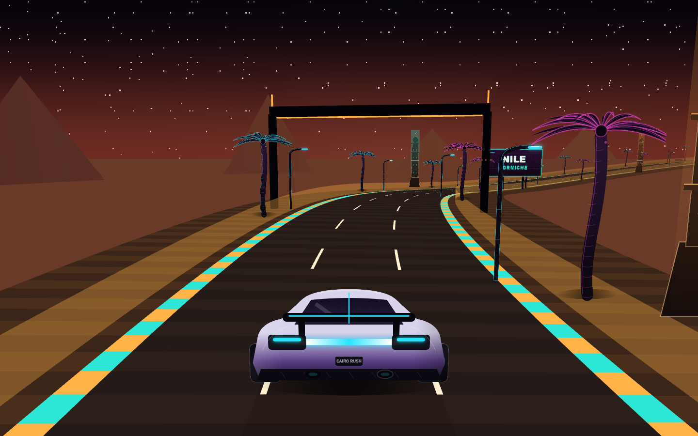

# 开罗狂飙 · CAIRO RUSH 8.3

一款可以直接在浏览器里玩的 **开罗街景 WebGL 3D** 街机赛车游戏。沿尼罗河、穿过汗哈利利老城、在吉萨金字塔与萨拉丁城堡之间狂飙。

无需安装、无需联网、无外部素材；车辆、赛道、城市、宣礼塔、金字塔、粒子和音效全部由代码实时生成。


## 开始游戏

直接双击 `index.html`（或双击 `启动游戏.bat`）即可开始。

- 推荐 Chrome / Edge 等现代浏览器
- 建议开启声音；音效和背景音乐使用 Web Audio 实时合成
- 支持键盘、手柄和触屏，支持横屏 / 竖屏
- 可在设置中安装为桌面/主屏幕应用，首次加载后支持离线
- 在线试玩：https://boriswzb.github.io/racing-game/

## 开罗场景

- **尼罗河滨海道**：沿尼罗河高速飞驰，在开罗塔与宣礼塔之间换线
- **汗哈利利老城**：穿过灯巷、拱门和香料市场，连续 S 弯
- **吉萨高原**：金字塔脚下的高速长弯，沙丘与落日压向赛道
- **萨拉丁城堡**：从城堡俯冲进老城，密集技术弯

场景中包含：

- 3D 金字塔、尼罗河岸沙地、暖色夕阳与沙尘雾
- 开罗宣礼塔、棕榈树、霓虹路灯、阿拉伯风格广告牌
- 金色 / 青绿色的开罗夜街路面、路肩、门架和城市远山
- 2D 兼容模式下的金字塔、宣礼塔与开罗天际线
- 跨越主赛道的高架立交桥、桥墩、护栏和桥底霓虹
- 更密集的高速弯、连续 S 弯、小半径组合弯和起伏



## WebGL 3D

- 默认使用 **WebGL** 渲染真实 3D 追逐场景
- 闭合 3D 赛道中心线，包含连续弯道、坡度与起伏
- 3D 追逐相机、透视投影、深度测试和雾化
- 3D 门架、护栏、路面霓虹和车辆接触阴影
- 车辆、棕榈树、宣礼塔、广告牌以 3D billboard 渲染
- 程序化天空、星空、夕阳、远山、金字塔与地平线
- 4 条赛道拥有不同的闭合 3D 路线与高度剖面
- 迷你地图使用真实 3D 赛道中心线
- 设置可切换：自动 / 3D · WebGL / 2D · 兼容
- WebGL 不可用或上下文丢失时自动回退 Canvas2D
- 2D 兼容模式使用同一套赛道曲率，保留完整玩法
- 回放与照片模式同时支持 3D 场景，照片会合成 WebGL 与粒子层

**确认 3D：** 打开「设置 → 渲染器」，底部显示 `当前渲染器：WEBGL 3D · v8.3`。也可以直接打开：

https://boriswzb.github.io/racing-game/?webgl=1

如果显示 `CANVAS 2D`，先强制刷新 `Ctrl+Shift+R`，或在开发者工具中注销 Service Worker。

## 三台赛车与永久改装

| 赛车 | 特点 | 解锁 |
| --- | --- | --- |
| VANTA RS | 均衡、稳定 | 初始 |
| KAZE GT | 轻量、转向快、加速强 | 800 CR |
| NOVA X | 极速最高、抓地较低 | 1800 CR |

每台车有 4 条改装线，各 5 级，永久保存：

- **ENGINE 引擎**：每级 +220 极速
- **CHASSIS 轮胎 / 悬挂**：每级 +0.04 抓地、+0.015 转向
- **NITRO 氮气系统**：每级 +220 氮气极速、加快回充
- **WEIGHT 轻量化**：每级 +260 加速

升级费用：120 / 200 / 320 / 480 / 700 CR。改装会实时反映在性能条和实际驾驶中；AI 不会升级。

## 3D 车库与涂漆

快速比赛设置中新增 **360° 3D 车模预览**：

- 车模支持自动旋转，也可以直接拖动旋转
- 可实时切换原厂漆、开罗金、尼罗河青、赤焰红、午夜蓝、沙漠沙
- 车漆会同步到 3D 比赛、2D 兼容模式、回放和照片
- 车漆保存在本地档案，下次打开仍然生效
- 3D 车库使用独立 Canvas 软件 3D 渲染，不依赖额外模型资源
- 当前为低多边形风格化车模，不是实车扫描模型；完全还原实车需要 GLTF/PBR 资产



## 生涯、挑战与成就

- 5 场逐步解锁的开罗地下赛事，从「初入开罗」到「开罗之王」
- 每日 3 个挑战，每日 00:00 刷新，完成自动发放 CR
- 12 个成就：首胜、收藏、生涯通关、赛道纪录、漂移、氮气、极速、零失误、每日挑战
- 车手档案集中查看每日挑战、成就、生涯统计和每条赛道本地 Top 5

## 驾驶与比赛

- 键盘：`WASD` / 方向键驾驶，`Space` 氮气，`P` 暂停，`M` 静音
- 手柄：左摇杆转向，RT 油门，LT 刹车，A 氮气，Start 暂停
- 触屏：左右转向、油门、刹车、氮气
- 支持自动油门、辅助转向和ABS 设置
- 6 台车同场，AI 会走线、躲避、使用氮气和尾流
- 碰撞、路肩、出界减速、尾流、氮气、漂移与完美起步
- 3D 追尾相机 + 屏幕震动 + 速度线 + 粒子

## 回放、幽灵与照片

- 比赛结束后可观看完整回放，支持暂停、拖动进度和 1× / 2× / 4× 速度
- 幽灵车与最佳圈速记录
- 可生成并分享异步幽灵挑战链接
- 回放中可进入照片模式，调整机位、焦距和滤镜
- 照片会保存到本地相册，可下载 PNG；照片导出使用 3D + 2D 合成
- 每条赛道保存本地 Top 5




## 存档与 PWA

- 车手档案、CR、胜场、改装、每日挑战、成就、纪录、照片均保存在本地
- 首次加载后支持离线；缓存版本 `cairo-rush-8.3.0`
- 支持安装到桌面 / 主屏幕
- 在线排行榜需要服务端，目前为本地成绩

## 技术

- 原生 HTML / CSS / JavaScript，无运行时依赖
- WebGL 1.0：动态 3D 赛道网格、3D 门架、金字塔、程序化天空、纹理 billboard、雾化
- Canvas 2D 兼容渲染、粒子、速度线、屏幕震动和 HUD
- Web Audio 实时合成引擎声、氮气、碰撞、倒计时和背景音乐
- 本地存储 + IndexedDB 照片库
- PWA Service Worker 离线缓存
- 响应式布局，支持桌面、手机竖屏和横屏

推荐 Chrome / Edge 90+、Firefox 90+、Safari 15+。  
默认优先 WebGL 3D；不支持 WebGL 或上下文丢失时自动回退 Canvas2D，也可在设置中手动选择「2D · 兼容」。

## 版本

- 8.3：车壳提升到 12 点圆润截面与更多纵向截面；新增跨越赛道的高架立交桥和更密集的高低速组合弯
- 8.2：车模改为连续车壳、圆润截面、整合式车顶/前后风挡、独立轮拱与圆柱车轮
- 8.1：3D 车库旋转视图、实时车漆预览与车漆同步
- 8.0.1：加宽三车道路面，让车身完整落在单车道内
- 8.0：开罗主题、新赛道命名、金字塔/宣礼塔/老城街景、开罗品牌与 PWA 更新
- 7.1：3D 霓虹门架、车辆接触阴影、渲染器状态显示
- 7.0：WebGL 真 3D 渲染器与 2D 回退
- 6.0：异步幽灵挑战链接
- 5.0：PWA 离线、画质档位、本地照片库

## 项目结构

```text
index.html            页面与界面
styles.css            霓虹 UI 与响应式布局
game.js               游戏主逻辑、3D/2D 渲染、音频
sw.js                 Service Worker
manifest.webmanifest  PWA 清单
icon-192.png          图标
icon-512.png          图标
apple-touch-icon.png  iOS 图标
preview*.png          游戏预览
```
