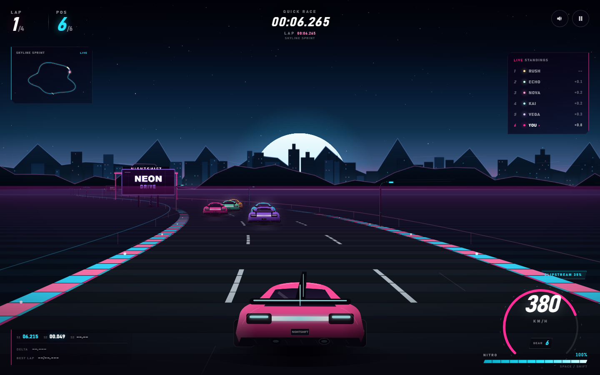

# NIGHTSHIFT · 霓虹极速 2.0

一款可以直接在浏览器里玩的霓虹合成波（Synthwave）风格伪 3D 街机赛车游戏。无需安装、无需联网、无外部素材，所有车辆、赛道场景、粒子和音效都由代码实时生成。

## 开始游戏

直接双击 `index.html`（或双击 `启动游戏.bat`）即可开始。

- 推荐使用 Chrome / Edge 等现代浏览器
- 建议开启声音；音效和背景音乐使用 Web Audio 实时合成
- 支持键盘、手柄和触屏，支持横屏 / 竖屏
- 在线试玩：https://boriswzb.github.io/racing-game/

## 2.0 内容

### 四条赛道

- **MIDNIGHT LOOP / 午夜环线**：适合第一次夜跑的高速环线
- **NEON HARBOR / 霓虹港湾**：连续 S 弯，节奏紧凑
- **CRIMSON PASS / 赤色山口**：大起伏、高速盲弯与荒漠灯光
- **SKYLINE SPRINT / 天际冲刺**：短促密集的城市技术赛道

每条赛道拥有独立的天色、雾色、山体、城市/荒漠装饰、路面霓虹与最佳纪录。

### 三台赛车

| 赛车 | 特点 | 解锁 |
| --- | --- | --- |
| VANTA RS | 均衡、稳定 | 初始 |
| KAZE GT | 轻量、转向快、加速强 | 800 CR |
| NOVA X | 极速最高、抓地较低 | 1800 CR |

赛车会实际影响极速、加速、抓地、转向、氮气消耗与回充。

### 生涯模式

5 场逐步解锁的赛事，从「第一夜」到「午夜之王」，包含不同赛道、圈数、AI 难度和领奖台目标。完成目标可获得 CR、解锁下一场赛事，并记录最佳名次与奖牌。

### 驾驶与比赛系统

- 带惯性、抓地、漂移和转向辅助的操控模型
- 实体护栏碰撞、出界减速、追尾与撞墙反馈
- 尾流（Slipstream）加速与实时提示
- 5 名 AI 对手：赛车线、超车避让、防守、失误与难度差异
- 起跑灯、倒计时、圈数、实时排名、分段计时、Delta、迷你地图
- 幽灵车（本赛道最快圈回放）
- 最佳单圈与赛道纪录本地保存
- 4 档镜头/辅助/自动油门/幽灵/音量设置
- 手柄支持：左摇杆转向、RT 油门、LT 刹车、A 氮气、Start 暂停

## 操作

| 操作 | 键位 |
| --- | --- |
| 转向 | `A` / `D` 或 `←` / `→` |
| 油门 | `W` / `↑` |
| 刹车 | `S` / `↓` |
| 氮气 | `Space` / `Shift` |
| 暂停 | `P` / `Esc` |
| 静音 | `M` |
| 重新开始 | `R` |

触屏端：左下角转向，右下角油门 / 刹车 / 氮气。设置中可开启「自动油门」。

## 小提示

- 高速过弯时会有离心力，提前反打方向，避免冲出赛道。
- 撞上护栏会大幅掉速并触发屏幕震动。
- 跟在对手正后方可以进入尾流，获得额外加速和氮气回充。
- 氮气会缓慢回充，每完成一圈额外补充；留在直道使用。
- 每场赛事结束后根据名次获得 CR；重复挑战可以刷新自己的赛道纪录和奖牌。
- 幽灵车默认开启，可以在设置中关闭。

## 技术特性

- 伪 3D 起伏赛道、透视投影、视差天空与动态雾化
- 程序化赛车 / 棕榈树 / 灯柱 / 广告牌 / 龙门架 / 荒漠岩石与仙人掌
- Canvas 2D 渲染、粒子、速度线、屏幕震动与动态 HUD
- Web Audio 合成引擎声、风噪、氮气声和 Synthwave 背景音乐
- 本地 profile 存档（CR、车辆、赛事奖牌、赛道纪录、幽灵车、设置）
- 响应式布局与触屏控制

## 文件

- `index.html` — 页面结构、HUD、赛事选择、生涯与设置界面
- `styles.css` — 界面、主题色与响应式样式
- `game.js` — 渲染、物理、AI、音效、存档与全部游戏逻辑
- `启动游戏.bat` — Windows 一键启动

## 浏览器兼容

推荐 Chrome / Edge 90+、Firefox 90+、Safari 15+。
游戏使用 Canvas 2D、Web Audio、Gamepad API、pointer events 和 `dvh` / `clip-path` 等现代 Web API。
